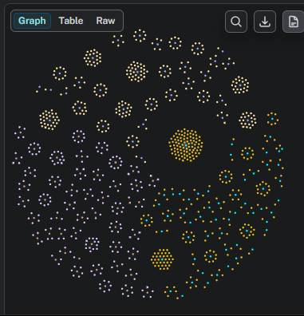

| Campo de ProgramaOficial      | Representación                                                          |
| ----------------------------- | ----------------------------------------------------------------------- |
| `programa_id`                 | Propiedad / ID                                                          |
| `codigo_programa`             | Propiedad                                                               |
| `codigo_snies`                | Propiedad                                                               |
| `snies_descripcion_abreviada` | Propiedad                                                               |
| `snies_distincion_genero`     | Propiedad                                                               |
| `estado`                      | Propiedad                                                               |
| `creditos_*`                  | Propiedades                                                             |
| `duracion_estudios`           | Propiedad                                                               |
| `intensidad`                  | Propiedad                                                               |
| `Facultad`                    | **Nodo + relación**                                                     |
| `Modalidad`                   | **Nodo + relación**                                                     |
| `NivelFormacion`              | **Nodo + relación**                                                     |
| `Ubicacion/Sede`              | **Nodo + relación**, si el dato es consistente                          |
| `CentroCostos`                | **Nodo + relación**, si el código permite identificarlo inequívocamente |
| `UnidadEstudio`               | **Nodo + relación**                                                     |

### Modelo 

    ProgramaOficial
        │
        ├── CONTIENE_UNIDAD ─────► UnidadEstudio
        │
        │
        └── relación semántica
                    │
                    ▼
                Formacion
                    │
                    └── TIENE_EVENTO ─────► Evento

    ProgramaOficial--------------
                                │
                        CONTIENE_UNIDAD
                                │
                                ▼
                            UnidadEstudio
                                ▲
                                │
                        similitud semántica
                                │
                            Formacion
                                │
                            TIENE_EVENTO
                                ▼
                            Evento

# tipos de evidencia:

    Formacion ──RELACIONADA_CON──► ProgramaOficial

    Formacion ──DESARROLLA/RELACIONADA_CON──► UnidadEstudio

    Formacion
    │
    │ similitud
    ▼
    UnidadEstudio
    │
    │ CONTENIDA_EN
    ▼
    ProgramaOficial

# Nucleo Cerebro Academico
    
                    ProgramaOficial
                   /               \
          CONTIENE_UNIDAD        RELACION_SEMANTICA
                /                     \
       UnidadEstudio ◄─────── Formacion
                                  │
                             TIENE_EVENTO
                                  │
                                  ▼
                                Evento

## Dejamos esa como regla arquitectónica
    Formacion  ←── similitud semántica ──→ ProgramaOficial
                    │                                      │
                    │                                      │
                    └── similitud semántica ──→ UnidadEstudio
                                                │
                                        CONTENIDA EN
                                                │
                                                ▼
                                            ProgramaOficial

## Definición Nodo Programa

    ProgramaOficial
        │
        ├── programa_id
        ├── codigo_programa
        ├── codigo_snies
        ├── descripcion_abreviada
        ├── distincion_genero
        ├── estado
        ├── facultad_snies
        ├── school
        ├── centro_costos
        ├── ubicacion
        │
        ├── creditos_minimos
        ├── creditos_maximos
        ├── creditos_optimos
        ├── duracion_estudios
        ├── intensidad
        │
        ├── fecha_aprobacion
        ├── vigencia_rnrc
        ├── vigencia_ac
        │
        └── relaciones
            │
            ├── TIENE_MODALIDAD ─────► Modalidad
            ├── TIENE_NIVEL ─────────► NivelFormacion
            ├── ES_TIPO ─────────────► TipoPrograma
            └── CONTIENE_UNIDAD ─────► UnidadEstudio

## Arquitectura resultante

                                Modalidad
                                    ▲
                                    │
                            TIENE_MODALIDAD
                                    │
                                    │
    TipoPrograma ◄── ES_TIPO ─ ProgramaOficial ─ TIENE_NIVEL ─► NivelFormacion
                                    │
                                    │
                            CONTIENE_UNIDAD
                                    │
                                    ▼
                            UnidadEstudio
                                    ▲
                                    │
                            SEMÁNTICA
                                    │
                                    │
                                Formacion
                                    │
                                    │
                            TIENE_EVENTO
                                    ▼
                                Evento

## Caminos semánticos complementarios

                             MATCH DIRECTO
    Formacion ─────────────────────────────────► ProgramaOficial
        │
        │
        │ MATCH CON UNIDAD
        ▼
    UnidadEstudio
        │
        │ pertenece estructuralmente
        ▼
    ProgramaOficial

## Obtenemos dos evidencias

        EVIDENCIA A
    ──────────────────────────────────

    Formacion
        │
        │ RELACIONADA_CON
        │ score: 0.86
        ▼
    ProgramaOficial

    EVIDENCIA B
    ──────────────────────────────────

    Formacion
        │
        │ RELACIONADA_CON
        │ score: 0.92
        ▼
    UnidadEstudio
        ▲
        │ CONTIENE_UNIDAD
        │
    ProgramaOficial

## Podemos encontrar casos donde existan ambas

                       score 0.84
        ┌──────────────────────────► ProgramaOficial
        │                                 │
    Formacion                                 │ CONTIENE_UNIDAD
        │                                 ▼
        └──── score 0.93 ─────────► UnidadEstudio

## Norte del proyecto

                             RUTA EAN
                            │
                            ▼
                    Perfil del usuario
                            │
              intereses + experiencia
              objetivo + conocimientos
                            │
                            ▼
              ┌─────────────────────────┐
              │ EDUCACIÓN CONTINUADA    │
              │       Formacion         │
              └────────────┬────────────┘
                           │
                 similitud semántica
                  ┌────────┴────────┐
                  ▼                 ▼
          UnidadEstudio      ProgramaOficial
                  │                 ▲
                  │ CONTIENE_UNIDAD │
                  └─────────────────┘
                           │
                           ▼
              ┌─────────────────────────┐
              │   PROGRAMA OFICIAL      │
              │ Pregrado / Esp. / Mtr.  │
              │       / Doctorado       │
              └─────────────────────────┘

FASE 3
════════════════════════════════════════════════════

                            Perfil
                             │
                ┌────────────┴────────────┐
                ▼                         ▼
            Formación EAN              Mercado laboral
                │                          │
        ┌────────┼────────┐                ▼
        ▼        ▼        ▼          OfertaLaboral
    Continuada   EANX   Programa           │
        │        |      Oficial            │
        │        │        │                │
        └────────┴────────┴────────────────┘
                    MATCH SEMÁNTICO
                        │
                        ▼
                competencias demandadas

## Grafo 

    CALL {
    MATCH ruta = (:Formacion)-[:TIENE_EVENTO]->(:Evento)
    RETURN ruta
    LIMIT 300

    UNION ALL

    MATCH ruta = (:ProgramaOficial)-[:CONTIENE_UNIDAD]->(:UnidadEstudio)
    RETURN ruta
    LIMIT 300

    UNION ALL

    MATCH ruta = (:FormacionEANX)-[:TIENE_MODULO]->(:ModuloEANX)
    RETURN ruta
    LIMIT 300
    }
    RETURN ruta;

## embedding realizado

    MATCH (n)
    WHERE n:ProgramaOficial OR n:UnidadEstudio OR n:Formacion
    OR n:FormacionEANX OR n:ModuloEANX
    RETURN
        labels(n) AS tipo,
        count(*) AS total,
        count(n.embedding) AS con_embedding,
        collect(DISTINCT n.embedding_model) AS modelos,
        collect(DISTINCT size(n.embedding)) AS dimensiones
    ORDER BY tipo;

    ╒═══════════════════╤═════╤═════════════╤══════════════════════════════════╤═══════════╕
    │tipo               │total│con_embedding│modelos                           │dimensiones│
    ╞═══════════════════╪═════╪═════════════╪══════════════════════════════════╪═══════════╡
    │["Formacion"]      │4912 │4742         │["intfloat/multilingual-e5-small"]│[384]      │
    ├───────────────────┼─────┼─────────────┼──────────────────────────────────┼───────────┤
    │["FormacionEANX"]  │169  │169          │["intfloat/multilingual-e5-small"]│[384]      │
    ├───────────────────┼─────┼─────────────┼──────────────────────────────────┼───────────┤
    │["ModuloEANX"]     │853  │853          │["intfloat/multilingual-e5-small"]│[384]      │
    ├───────────────────┼─────┼─────────────┼──────────────────────────────────┼───────────┤
    │["ProgramaOficial"]│820  │349          │["intfloat/multilingual-e5-small"]│[384]      │
    ├───────────────────┼─────┼─────────────┼──────────────────────────────────┼───────────┤
    │["UnidadEstudio"]  │839  │839          │["intfloat/multilingual-e5-small"]│[384]      │
    └───────────────────┴─────┴─────────────┴──────────────────────────────────┴───────────┘

## Calcularemos candidatos entre estos conjuntos:

| Origen | Destino |
|---|---|
| `Formacion` | `UnidadEstudio` y `ProgramaOficial` |
| `FormacionEANX` | `UnidadEstudio`, `ProgramaOficial` y `Formacion` |
| `ModuloEANX` | `UnidadEstudio` y `Formacion` |

## Relación Semantica 

    Formacion: 4742 embeddings compatibles
    ProgramaOficial: 349 embeddings compatibles
    UnidadEstudio: 775 embeddings compatibles
    FormacionEANX: 169 embeddings compatibles
    ModuloEANX: 853 embeddings compatibles
    Formacion: 3936 grupos de texto para comparar
    ProgramaOficial: 113 grupos de texto para comparar
    UnidadEstudio: 588 grupos de texto para comparar
    FormacionEANX: 169 grupos de texto para comparar
    ModuloEANX: 33 módulos genéricos excluidos
    ModuloEANX: 525 grupos de texto para comparar

